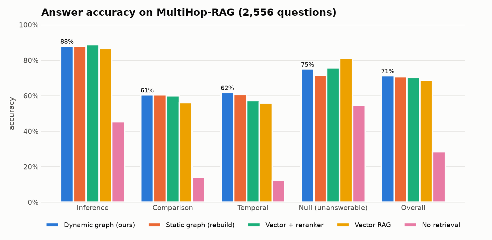
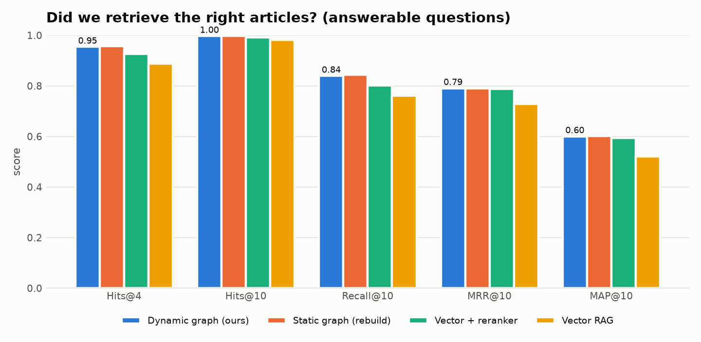
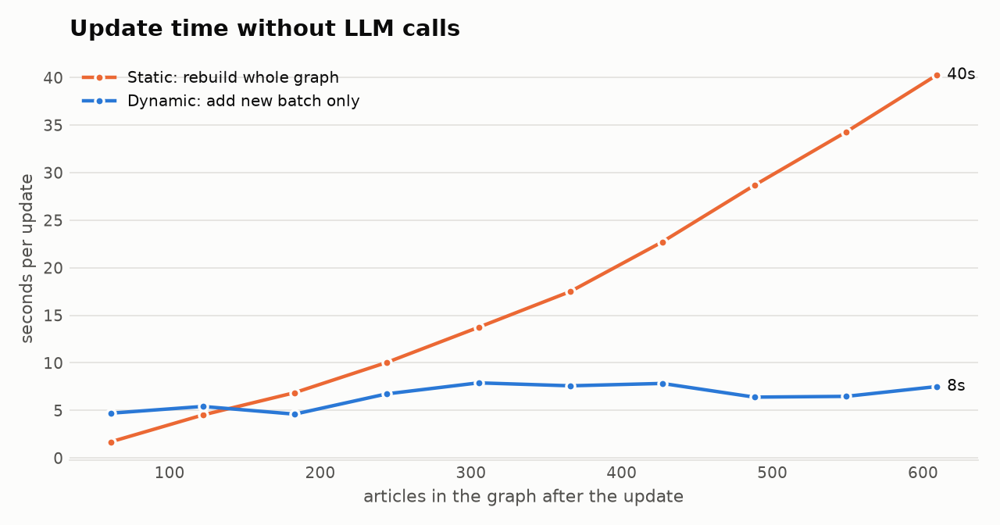

# Dynamic Graph RAG

A knowledge-graph question-answering system over news that **updates its graph incrementally as new articles
arrive**, instead of rebuilding it. Everything runs locally on one 12 GB GPU.

- **LLM:** Qwen2.5-7B-Instruct, 4-bit GGUF (Q4_K_M), served by `llama-server` (llama.cpp) with 16 parallel slots
  and JSON-schema-constrained output
- **Embeddings:** BAAI/bge-base-en-v1.5 (fp16)
- **Storage:** SQLite (source of truth) + FAISS (3 indexes: chunks, entities, relations; FAISS id = SQLite row id)
  + networkx (in-memory graph view)
- **Data:** [MultiHop-RAG](https://huggingface.co/datasets/yixuantt/MultiHopRAG): 609 news articles, 2,556 questions

The design, every decision and every bug (with cause and fix) are in [PLAN.md](PLAN.md). A plain-language report
with interview Q&A is in [report/Dynamic_Graph_RAG_Report.pdf](report/Dynamic_Graph_RAG_Report.pdf).

## How it works

```
article ─► dedupe (hash) ─► sentence chunks (400 tok) ─► bge vectors ─► SQLite + FAISS
                                     │
                                     └─► Qwen extracts {entities, relations} as JSON ─► cleaning + grounding checks
                                                                                          │
   existing graph ◄── entity resolution: alias ─► FAISS kNN + name/type rules ─► LLM judge ─► new node
                 ◄── edge upsert (weight, evidence chunks, valid_from/valid_to; newer functional facts supersede older)

question ─► seeds (aliases, entity/relation/chunk vectors, named sources) ─► 2-hop walk + personalised PageRank
         ─► chunks ranked by similarity + 0.05·graph bonus + 0.1·source boost (≤2 per article)
         ─► Qwen answers from 8 chunks + top facts
```

## Results (all 2,556 questions)

Same LLM, prompt and 8 evidence chunks for every system; only retrieval differs.



| System | Overall | Inference | Comparison | Temporal | Null | False "no info" |
|---|---|---|---|---|---|---|
| **Dynamic graph (ours)** | **71.4%** | 88.1% | 60.6% | 61.9% | 75.1% | 12.9% |
| Static graph (full rebuild) | 70.7% | 88.1% | 60.6% | 60.7% | 71.8% | 13.0% |
| Vector RAG + reranker | 70.4% | 88.7% | 59.9% | 57.3% | 75.8% | 13.6% |
| Vector RAG | 68.7% | 86.6% | 56.1% | 55.9% | 81.1% | 17.0% |
| No retrieval | 28.5% | 45.3% | 14.1% | 12.3% | 54.8% | 60.3% |



| System | Hits@4 | Hits@10 | Recall@10 | MRR@10 | MAP@10 |
|---|---|---|---|---|---|
| **Dynamic graph (ours)** | 0.954 | 0.997 | 0.840 | 0.791 | 0.600 |
| Static graph (full rebuild) | 0.957 | 0.997 | 0.843 | 0.790 | 0.602 |
| Vector RAG + reranker | 0.927 | 0.992 | 0.802 | 0.788 | 0.594 |
| Vector RAG | 0.888 | 0.982 | 0.760 | 0.729 | 0.521 |

### Incremental update vs full rebuild

Articles streamed in date order, 10 batches. Without LLM calls (pure graph-building work):



| Articles in graph | 61 | 183 | 305 | 427 | 609 |
|---|---|---|---|---|---|
| Dynamic update (s) | 4.7 | 4.6 | 7.9 | 7.8 | **7.5** |
| Static rebuild (s) | 1.7 | 6.9 | 13.7 | 22.7 | **40.3** |

With the LLM judge on, both are dominated by new judge calls (cached answers help the rebuild): 753 s vs 939 s in
total. A rebuild that also re-ran extraction would cost ~70 GPU-minutes each time.

### Honest reading

- Dynamic ≈ static in quality: greedy incremental entity resolution loses nothing measurable, at ~5× lower update cost.
- The retrieval ablation (`results/ablation_retrieval.json`) shows most of the ranking gain comes from
  **source-aware retrieval** (questions name their publishers); the graph bonus itself changes ranking little.
  The graph's value is in **facts in the prompt** (+3.4 pts on answerable dev questions), **cheap updates with
  dated facts**, and **explainable evidence**.
- Three retrieval weights were tuned on a 300-question subset of the test questions.

## Usage

```bash
source ~/ml-env/bin/activate
pip install -e .
dgrag download && dgrag load-docs          # dataset -> SQLite
dgrag chunk-embed                          # chunks + vectors (SQLite + FAISS)
dgrag extract                              # LLM extraction, resumable (~70 min)
dgrag stream --batches 10                  # builds dynamic + static graphs, timing experiment
dgrag eval dynamic static vector vector_rerank none
dgrag ask "Who founded FTX?" --system dynamic
dgrag add-article new.json --graph demo   # add one article to a copy of the graph, no rebuild
streamlit run app/streamlit_app.py         # demo: ask, add article, explore graph
python -m pytest                           # tests
```

`scripts/run_all.sh` runs the full experiment pipeline after extraction (~4.5 h on an RTX 4070 Ti).
llama.cpp is built in `third_party/llama.cpp/build/bin/llama-server`; the GGUF model lives in `models/`.
